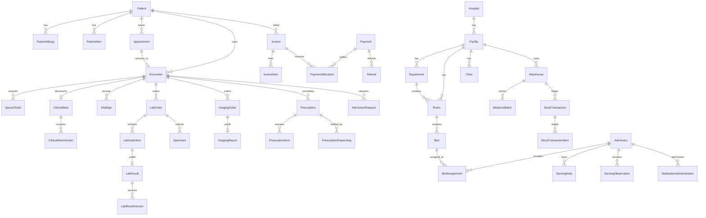

# Kiến trúc & Sơ đồ cơ sở dữ liệu (ARCHITECTURE & ERD)

## 1. Kiến trúc Modular Monolith

```text
SmartHospital.sln
├── src/SmartHospital.Domain          (POCO Entities, Enums, Constants, DomainException)
├── src/SmartHospital.Contracts       (DTOs, PagedRequest/Result, ApiErrorResponse)
├── src/SmartHospital.Application     (Use-case Services, IHospitalDbContext, Integration Interfaces)
├── src/SmartHospital.Infrastructure  (HospitalDbContext, EF Migrations, DatabaseInitializer,
│                                      HospitalDataSeeder, Identity, Audit, LocalDocumentStorage,
│                                      Demo/Sandbox Adapters)
└── src/SmartHospital.Web             (ASP.NET Core MVC Areas, API v1, Middleware,
                                       Permission Policy Authorization, Print Views)
```

### Quy tắc phụ thuộc
- `Domain` không tham chiếu bất kỳ layer nào.
- `Application` chỉ phụ thuộc `Domain`, `Contracts` và `Microsoft.EntityFrameworkCore`.
- `Infrastructure` triển khai `IHospitalDbContext`, ASP.NET Core Identity, SQL Server bootstrap và adapter tích hợp.
- `Web` xử lý HTTP/UI, CSRF, rate limiting, cookie security, permission policies và gọi `Application`.

## 2. Sơ đồ quan hệ dữ liệu cốt lõi (ERD)



## 3. Các ràng buộc toàn vẹn chính
- **Khóa chính & Concurrency:** `Guid` cho entity nghiệp vụ (`rowversion` optimistic concurrency), `bigint` cho `AuditLogs` và `IntegrationMessages`.
- **Không Cascade Delete** trên dữ liệu y tế/tài chính (`DeleteBehavior.Restrict`).
- **Ràng buộc duy nhất (Unique Indexes):** `Patient.PatientCode`, `Encounter.EncounterCode`, `QueueTicket(FacilityId, ClinicId, QueueDate, SequenceNumber)`, `Specimen.Barcode`, `BedAssignment(BedId) WHERE IsCurrent = 1`, `Invoice.InvoiceCode`, `Payment.ReceiptNumber`, `StockTransaction.TransactionCode`.
- **Snapshot dữ liệu:** Đơn giá và tên dịch vụ/thuốc được chụp lại tại thời điểm tạo chỉ định/hóa đơn.
